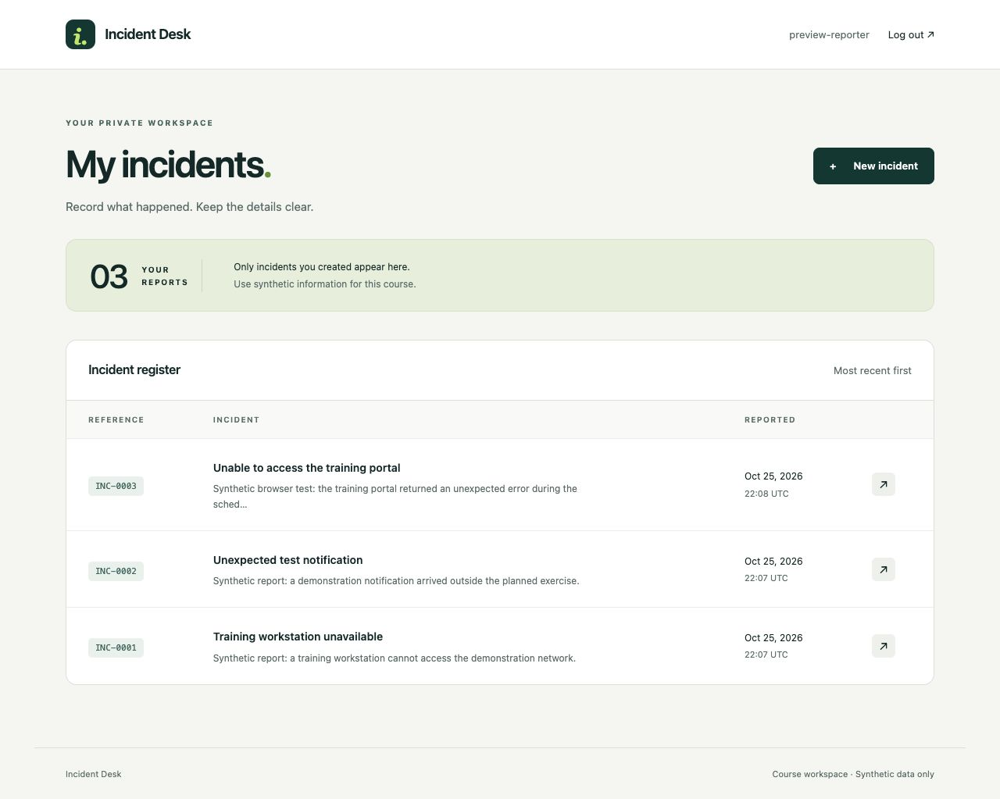

# Incident Desk — Django Course Starter

A small, working incident-management application for an application-security capstone. Start with a safe private reporting workflow, push it to your personal GitHub repository, deploy it, and add functionality and security automation over six weeks.

**Version 0:** login/logout, private incident creation/list/detail, administrator-managed accounts, migrations, synthetic local sample records, and automated security regression tests. No public registration, file uploads, email, analyst assignment, comments or status workflow yet.



## What you need

- Python 3.12 or 3.13 (the course/CI target is 3.12).
- Git; Docker Desktop/Engine with Compose for local PostgreSQL.
- A personal GitHub account. Deployment also requires a personal Vercel Hobby account and an isolated hosted PostgreSQL database, for example a free Neon database.
- No frontend package manager or JavaScript build tool is required.

Work **inside this folder**: the one containing manage.py. If using the downloadable ZIP, extract it first. This repository should contain Incident Desk only, not the deliberately vulnerable course lab apps.

## 1. Create your Python environment

macOS/Linux:

```bash
python3 -m venv .venv
source .venv/bin/activate
python -m pip install -r requirements.txt
```

Windows PowerShell:

```powershell
py -3.12 -m venv .venv
.\.venv\Scripts\python.exe -m pip install -r requirements.txt
```

On Windows you may keep using `.\.venv\Scripts\python.exe` wherever this guide says `python`; activation is optional.

## 2. Configure local development

Copy .env.example to .env in your editor/file manager. Generate a private local key:

```bash
python -c "import secrets; print(secrets.token_urlsafe(50))"
```

Paste it into DJANGO_SECRET_KEY in .env. Keep the local settings module and database URL from the example. .env is ignored by Git. Do not put this key in a screenshot, report or GitHub commit. If omitted locally, a temporary key is generated and restarts invalidate sessions.

Start the database:

```bash
docker compose up -d --wait db
python manage.py migrate
python manage.py createsuperuser
python manage.py runserver 127.0.0.1:8000
```

The database is exposed only on **127.0.0.1:55432**, to reduce clashes with existing PostgreSQL installations. Its fixed password is for local Docker development only, never a hosted database. If the port is occupied, change compose.yml and DATABASE_URL together; do not stop an unrelated service.

Open http://127.0.0.1:8000/admin/ and sign in with your newly created superuser. Under Users, add a normal reporter account with a unique password and leave Staff status/Superuser status unchecked. Log out, then use http://127.0.0.1:8000/accounts/login/ as that reporter.

The superuser is an administrative identity and can inspect records through Django admin; normal application views show only the signed-in user's own incidents, even if the user is staff. Administrative account management is a starting tool, not the future custom administrator role.

Optional local sample records (in another terminal with the same environment):

```bash
python manage.py seed_incidents --username YOUR_REPORTER_USERNAME
```

This command creates two synthetic records once, creates no accounts/passwords, and refuses production settings. Replace the username placeholder. Public deployments must not use shared demo passwords.

## 3. Try the workflow

1. Sign in as your reporter.
2. Create an incident with a title and description using synthetic information.
3. Open the report from the register.
4. Create a second normal user through admin; verify their register does not show the first reporter's incident.
5. Try the first report's URL as the second user: the expected result is 404.
6. Log out using the button, which submits a CSRF-protected POST.

Controls already present: Django authentication/password hashing, database sessions, session rotation on login, logout invalidation, CSRF middleware/form tokens, ORM queries, template autoescaping, server-selected ownership, owner-scoped queries, input limits, private-page no-store headers, and an application CSP.

These are a foundation, not a production security certification. Login throttling, richer access policy, audit events and operational monitoring are student work. Do not use real incident/personal data in this course application.

## 4. Run tests

Fast, isolated tests (in-memory SQLite, no Docker needed):

```bash
python manage.py test --settings=config.settings.test
python manage.py makemigrations --check --dry-run --settings=config.settings.test
```

PostgreSQL integration tests (local database running):

```bash
python manage.py test --settings=config.settings.ci
```

PostgreSQL test credentials need permission to create/drop a disposable test database; the local course DB user has this. Never run tests against production. `test` and `ci` settings intentionally use fast MD5 hashes only to speed isolated tests; they must never be selected for a deployment. Local/production use Django's normal password hashers.

`.github/workflows/tests.yml` runs both test variants on pushes and pull requests. SAST, dependency/secret scanning and DAST are deliberately left as milestones in [docs/MILESTONES.md](docs/MILESTONES.md).

## 5. Publish your code to GitHub

Use the instructor's GitHub template when available, or create an empty **personal** repository and follow [docs/GITHUB.md](docs/GITHUB.md). Review `git status` before the first commit. `.venv`, `.env`, database files and generated staticfiles must not be uploaded.

## 6. Deploy

Follow [docs/DEPLOYMENT.md](docs/DEPLOYMENT.md). The app is configured for Vercel's native Django detection, not a Docker deployment. Use hosted PostgreSQL; a local SQLite file cannot persist application writes on Vercel. Migrations and initial administrator creation are explicit operations; they never run on HTTP requests or automatically in the build.

## Project map

| Path | Purpose |
|---|---|
| config/settings/ | Local, production and isolated test settings |
| incidents/models.py | The initial incident model |
| incidents/forms.py | Explicit editable fields and validation |
| incidents/views.py | Private list/detail and server-owned create |
| incidents/tests/ | Behavior, ownership, CSRF, sessions and deployment config tests |
| templates/ and static/ | Server-rendered pages and local CSS |
| docs/ | GitHub, deployment, teaching milestones, threat-model scaffold and validation |

For local shutdown use `docker compose stop`. Restart with `docker compose up -d --wait db`. `docker compose down` removes containers while retaining the database volume. **`docker compose down -v` deletes this project's database**, including accounts and reports: use it only for an intentional reset.

## Optional deliberate-flaw challenge

The added [SQL injection challenge](exercises/sql-injection/README.md) runs only under isolated local security_lab settings with a disposable synthetic SQLite database. It is absent from normal app routes and forbidden on Vercel. Students use ZAP/manual requests, repair the query and pass an explicit five-test hardening gate. The regular test workflow deliberately does not grade this opt-in challenge unless its job is added. The instructor keeps the solution guide and an independent test copy for assessment.
